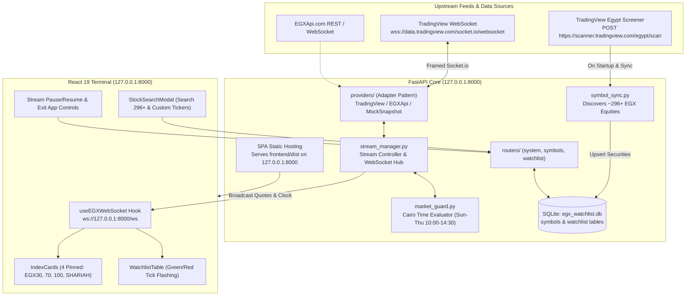
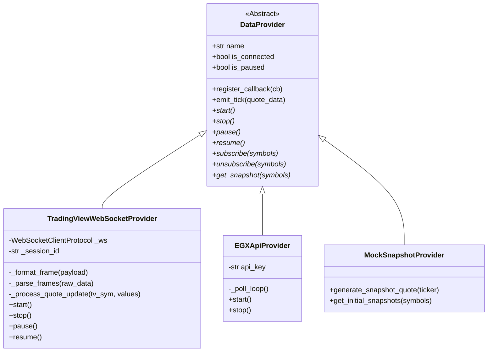
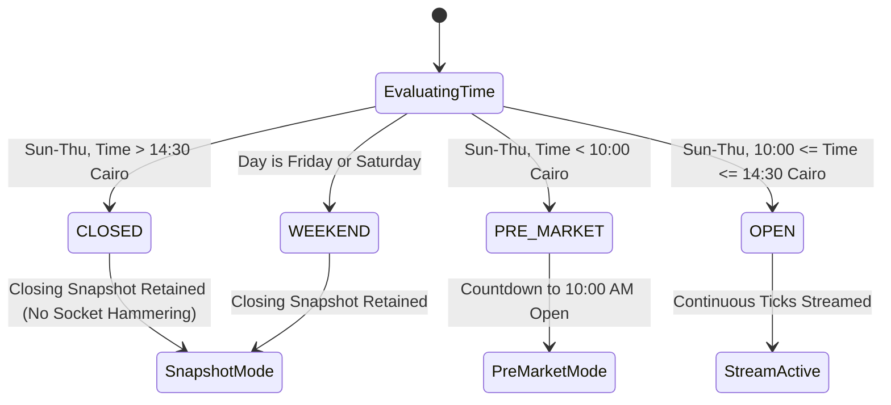
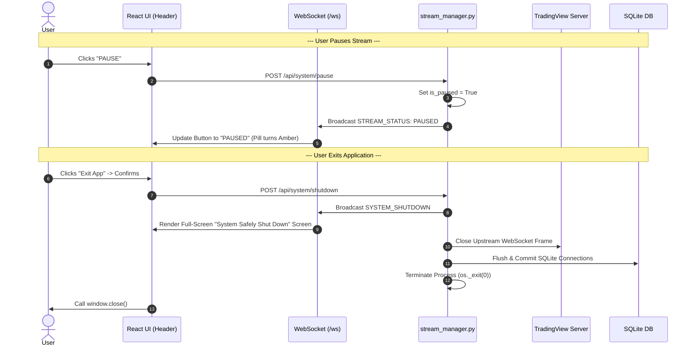

# EGX Real-Time Watchlist & Terminal — Architecture Blueprint

This document details the architectural design, data pipelines, protocols, and failure modes of the **Egyptian Exchange (EGX) Real-Time Watchlist & Terminal**.

---

## 1. System Topology Overview



---

## 2. Dynamic Full-Market Discovery (`symbol_sync.py`)

Rather than relying on brittle, outdated static arrays, the terminal performs dynamic market discovery:

1. **Startup Discovery**:
   - Sends a filter query to `https://scanner.tradingview.com/egypt/scan` with `exchange = 'EGX'` and a range of `[0, 500]`.
   - Discovers all active Egyptian Exchange listings (~296+ equities across EGX 30, EGX 70, EGX 100, and recent IPOs such as `ACTF` and `COPR`).
2. **Local Caching & Enrichment**:
   - Extracted listings are merged with curated Arabic company names (`name_ar`) and sector classifications (`sector_ar`).
   - Cached into the local SQLite `symbols` table for sub-millisecond autocomplete and search filtering.
3. **On-The-Fly Custom Ticker Fallback**:
   - If an investor inputs a newly listed IPO ticker that has not yet completed screener indexing, clicking **"Add Custom EGX Ticker: [SYMBOL]"** immediately registers the symbol as `EGX:[SYMBOL]`, subscribes upstream, and begins streaming.

---

## 3. Modular Data Provider (Adapter Pattern)

All market feeds implement the abstract [`DataProvider`](file:///backend/app/providers/base.py) interface:



### TradingView Framing & Heartbeat Handling
TradingView utilizes Socket.IO packet framing:
- **Packet Structure**: `~m~<byte_length>~m~<payload>`
- **Heartbeat Echo**: Incoming `~m~3~m~~h~1` frames require an identical `~m~3~m~~h~1` reply within 10 seconds to maintain session liveness.
- **Session Handshake**:
  1. `set_auth_token`: Authenticates using user token or `"unauthorized_user_token"`.
  2. `quote_create_session`: Creates a private quote session (e.g. `qs_xxxxxxxxxxxx`).
  3. `quote_set_fields`: Registers required tick properties (`lp`, `ch`, `chp`, `high_price`, `low_price`, `open_price`, `prev_close_price`, `volume`).
  4. `quote_add_symbols`: Subscribes solely to active watchlist tickers + 4 pinned indices.

### Symbol Normalization & Shariah Index Quirk
- Standard tickers map directly: `COMI` $\rightarrow$ `EGX:COMI`.
- **EGX 33 Shariah Index Quirk**: In TradingView's ticker symbology, the official Shariah index is designated as `EGX:EGX33SHR`. The adapter seamlessly maps between internal symbol `SHARIAH` and upstream `EGX:EGX33SHR`.

---

## 4. Market Hours Guard (`market_guard.py`)

The Egyptian Exchange follows Egyptian workweek conventions:
- **Trading Days**: Sunday through Thursday.
- **Weekend**: Friday and Saturday.
- **Session Timing**: 10:00 to 14:30 Africa/Cairo time (`pytz.timezone('Africa/Cairo')`).



---

## 5. Lifecycle, Stream Pause & Graceful Shutdown



---

## 6. Single-Port Packaging & Standalone Desktop App

### Single-Port Serving Architecture
FastAPI in `backend/main.py` serves both:
1. REST API & WebSockets on `/api/*` and `/ws`.
2. Static compiled React assets (`frontend/dist`) on `/` and `/assets/*` with SPA fallback.
This eliminates the need for separate Node/Vite runtimes in production.

### Desktop Launcher (`desktop_launcher.py`)
- Runs Uvicorn in a daemon thread bound to `127.0.0.1:8000`.
- Attempts native window creation via `pywebview`.
- Automatically falls back to Microsoft Edge / Google Chrome in App Mode:
  ```powershell
  msedge.exe --app=http://127.0.0.1:8000 --window-size=1320,860
  ```
- Automatically triggers `/api/system/shutdown` when the window is closed, cleanly freeing port 8000.
